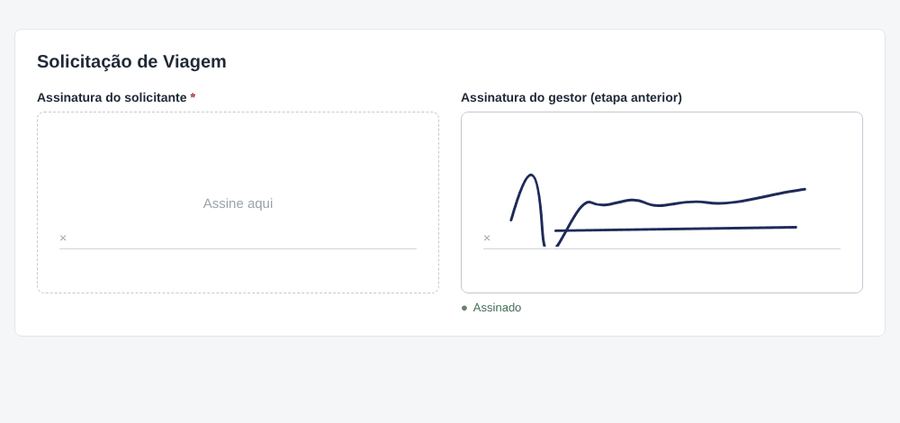

# fluig-assinatura

Campo de **assinatura** para formulários do Fluig. A pessoa assina com o mouse, o dedo ou a caneta, e a assinatura fica salva na solicitação como um campo do formulário. Nas etapas seguintes, ela aparece só para leitura.

O passo a passo completo está no post **[Como colocar um campo de assinatura no formulário do Fluig](https://lucaslima.dev/blog/assinatura-no-formulario)**, no lucaslima.dev.



## O que este projeto faz

- Cria uma área de assinatura com `canvas` e **jQuery**, sem biblioteca. Funciona com mouse, toque e caneta.
- Permite **desfazer** o último traço e **limpar** a assinatura.
- Grava a assinatura como **imagem PNG em base64** num `textarea` do formulário. O Fluig salva esse campo junto com a ficha, sem nenhum passo a mais.
- Mostra a assinatura **só para leitura** quando o campo está desabilitado, nas etapas seguintes do processo.
- Bloqueia o envio quando a assinatura obrigatória está vazia, no navegador e no servidor.

> **Não é assinatura digital.** O desenho registra a concordância da pessoa no processo, mas não tem certificado. Para documentos que exigem validade jurídica, use uma solução de assinatura eletrônica.

## Estrutura

```
fluig-assinatura/
├── events/
│   ├── displayFields.js   ← deixa a assinatura só para leitura fora da atividade inicial
│   └── validateForm.js    ← assinatura obrigatória, validada no servidor
├── docs/preview.gif
├── index.html             ← o bloco da assinatura no formulário
├── style.css              ← estilo do componente
└── script.js              ← o componente e o beforeSendValidate
```

## Como testar

1. Clone o repositório e abra o `index.html` no navegador.
2. Assine na área tracejada. Use **Desfazer** e **Limpar** para testar os botões.
3. Para ver o valor gravado, rode no console: `$('#assinaturaSolicitante').val()`. O resultado começa com `data:image/png;base64,`.

## Usando no seu formulário

1. **Copie o bloco `.assinatura`** do `index.html` para o HTML do seu formulário. Troque o `name` e o `id` do `textarea` se quiser outro nome de campo.
2. **Inclua o `style.css` e o `script.js`** no formulário. O jQuery o Fluig já carrega, então a linha do jQuery no `index.html` não vai para o Fluig.
3. **Copie os eventos** da pasta `events` para o seu formulário e troque o `4` pelo número da atividade inicial do seu processo.
4. **Para mais de uma assinatura**, como a do solicitante e a do gestor, repita o bloco com outro `name` no `textarea` e ajuste o `displayFields` para liberar cada campo na atividade certa.

## Como a assinatura fica salva

- A cada traço, o `script.js` atualiza o `textarea` escondido com a imagem. Quando a solicitação é enviada, o Fluig grava o campo na ficha do formulário.
- Nas etapas seguintes, o `displayFields` desabilita o campo com `form.setEnabled`. O componente percebe e mostra a imagem gravada em vez da área de desenho.
- Para usar a assinatura depois, leia o campo como qualquer outro: `hAPI.getCardValue("assinaturaSolicitante")` num evento do processo, ou a coluna `assinaturaSolicitante` no dataset do formulário.
- Para transformar a assinatura em arquivo, use `Assinatura.paraArquivo(valor, 'assinatura.png')`, que devolve um `File` pronto para anexar.

## Cuidados

- **Use `textarea`, não `input`.** A assinatura tem entre 10 e 30 mil caracteres, e um `input` pode ter limite de tamanho no banco. Teste com uma assinatura grande e confira se ela volta inteira.
- **Mantenha o `form.setShowDisabledFields(true)`** no `displayFields`. Sem ele, o Fluig pode trocar o campo desabilitado por texto, e o componente não encontra a imagem.
- **Grave quem assinou.** O desenho sozinho não identifica a pessoa. Salve junto o usuário e a data em campos do formulário.

---

Criado por [Lucas Lima](https://lucaslima.dev) · [@luccsll](https://www.linkedin.com/in/luccsll)
